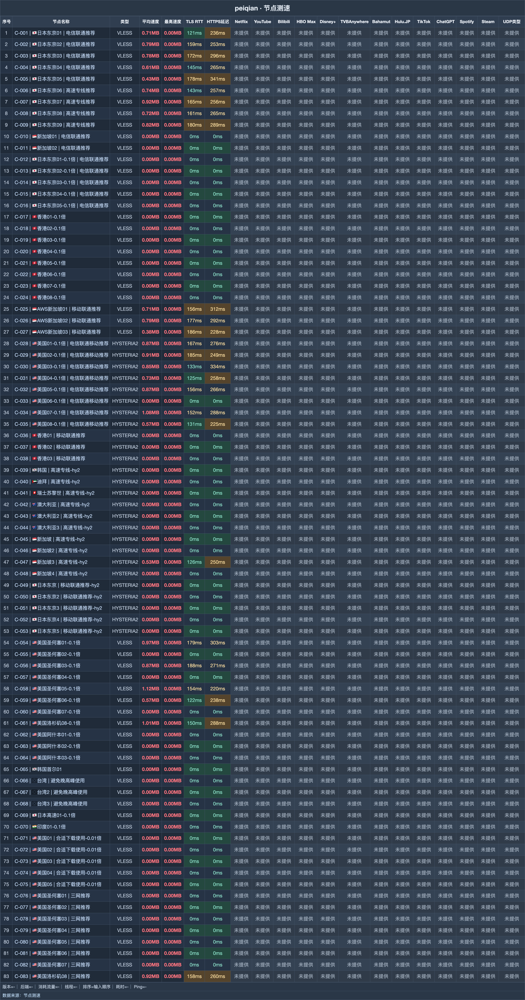

# 赔钱机场测速与节点怎么选？美区 0.1 倍、大流量场景及三家对比（2026-11-18）

> **先看赔钱机场测速与地域结论：**2026-10-17 的历史输入有 83 个节点，该轮连通 26 个；延迟中位 154ms、速度中位 6.5 MB/s，最快平均速度 9.2 MB/s。**常用美区**，先验证已连通的 0.1 倍节点；**常用日本、新加坡或香港**，不要把美区低倍率当成购买理由，应先核对应地区节点。它的购买重点不是单次速度第一，而是美国节点数量、0.1 倍扣量和大流量套餐。
>
> 👉 **[先用 1.5 元月付验证美区与运营商适配](https://xn--mes358aby2apfg.com/register?code=qhyiSP1G&cover=sfw)** · 美区用户先测已连通的 0.1 倍节点；非美区用户先核常用地区，再决定是否升大容量档。

## 赔钱机场适合哪些使用场景

**更适合：**

- 下载、PT 或高码率视频用量大，流量成本比低延迟更重要。
- 主要使用美国线路，愿意围绕 0.1 倍节点安排任务。
- 想用 1.5 元低成本验证，不希望首月投入太多。
- 偏好不限时流量包，或需要 1000G 以上的周期套餐。

**不太适合：**

- 要求整份订阅所有节点同时可用；该轮只有 26/83 连通。
- 常用落地不是美国，又把 0.1 倍作为唯一购买理由。
- 不接受“每天流量限制为总的 20%”的公平使用规则。
- 只看 20TB 等大数字，不核实际每天可用量、倍率和节点连通。

| 首屏判断 | 已核信息 |
|---|---|
| 历史测试时间 | 2026-10-17 18:39–18:48 |
| 测试环境 | 中国大陆家宽出口香港；每节点连测 3 次取最优 |
| 节点 / 连通 | 83 / 26 |
| 延迟中位 | 154 ms |
| 速度中位 | 6.5 MB/s |
| 最快平均速度 | 9.2 MB/s |
| 低倍率记录 | 12 个 0.1 倍节点 |
| 月付起点 | 1.5 元 / 100G |
| 协议 | VLESS / Hysteria2 |

## 怎么读赔钱机场测速

先把“83 个节点”和“26 个连通”分开：83 是该轮输入规模，26 才是该轮成功连接并能进入速度比较的样本。**不能用最快节点替代整体连通判断，也不能把一次未连通写成永久不可用。**

历史样本中的高均速节点如下：

| 节点 | 倍率 / 提示 | 延迟 | 完整请求 | 平均速度 | 最高速度 |
|---|---|---:|---:|---:|---:|
| 美国圣何塞05 | 0.1 倍 | 152ms | 223ms | **9.15 MB/s** | 11.14 MB/s |
| 美国07 | 0.1 倍；电信联通移动推荐 | 149ms | 280ms | **8.92 MB/s** | 11.15 MB/s |
| 美国洛杉矶08 | 0.1 倍 | 151ms | 292ms | **8.34 MB/s** | 11.60 MB/s |
| 美国圣何塞01 | 0.1 倍 | 177ms | 308ms | **7.91 MB/s** | 10.87 MB/s |
| 美国洛杉矶08 | 三网推荐 | 158ms | 261ms | **7.58 MB/s** | 12.01 MB/s |
| 日本东京07 | 高速专线推荐 | 165ms | 262ms | **7.54 MB/s** | 12.35 MB/s |
| 美国02 | 0.1 倍；电信联通移动推荐 | 184ms | 254ms | **7.52 MB/s** | 10.97 MB/s |
| 美国圣何塞03 | 0.1 倍 | 186ms | 264ms | **7.15 MB/s** | 11.66 MB/s |

### 这份测速最值得看的不是峰值，而是“可连节点 × 倍率”

1. **先筛连通节点。**未连通节点不能因为名称或倍率好看就进入当前候选。
2. **再按运营商筛。**“电信联通推荐”“三网推荐”只是选线提示，仍需在自己的网络复测。
3. **最后看速度与倍率。**高均速表前四名都是美国 0.1 倍节点，这正是赔钱机场最鲜明的场景优势。
4. **不把 0.1 倍写成性能保证。**倍率决定额度扣减，不决定延迟、速度或长期稳定性。

## 赔钱机场节点怎么选：先按地域，再看倍率

83 个节点分布为：美国 32、日本 20、香港 11、新加坡 9；台湾和澳大利亚各 3，韩国 2，迪拜、瑞士、印度各 1。0.1 倍线路集中在美国。

### 场景一：美区大文件下载、PT、长期高流量

优先从**已连通的美国 0.1 倍节点**测试。同样传输量按 0.1 倍扣量，理论上 100G 标称额度可承载约 1000G 实际传输；但每日仍受总额度 20% 规则约束。

### 场景二：日常网页和低成本试用

先买 1.5 元 / 100G 的一瓶盖可乐。此阶段目标是确认本地运营商、晚高峰和常用地区，不是用最小档推断所有线路。

### 场景三：日本或新加坡为主

不要只因站内有 0.1 倍节点就购买。日本有 20 个、新加坡有 9 个，但 0.1 倍主要集中在美国；应按所需地区的实际候选来算成本。

### 场景四：用量不按月发生

不限时流量包从 18.90 元 / 1000G 起，另有 4000G、6000G、20000G 与 99999G。把一次性付款和月付分开比较，避免把“永久订阅”当作每月重置额度。

## 套餐与每日规则

| 套餐名称 | 流量 | 设备 | 限速 | 一次付 | 月付 | 季付 | 半年 | 年付 | 两年 | 三年 |
|---|---|---|---|---|---|---|---|---|---|---|
| 一瓶盖可乐 | 100G | 10 | 不限 | — | **1.50 元** | — | 9 | 18 | 36 | 54 |
| 中瓶可乐 | 500G | 15 | 不限 | — | **2.99 元** | — | 17.99 | 34.99 | 68.99 | 99.99 |
| 大瓶可乐 | 1000G | 20 | 不限 | — | **5.99 元** | — | 34.99 | 68.99 | 133.99 | 199.99 |
| 超大瓶可乐 | 5000G | 30 | 不限 | — | **12.99 元** | — | 73.99 | 139.99 | 265.99 | 375.99 |
| 水桶可乐 | 20000G | 40 | 不限 | — | **39.99 元** | — | 225.99 | 429.99 | 810 | 1150.99 |
| 企业套餐(300台设备数量支持) | 99999G | 300 | 不限 | — | **280 元** | 798 | 1515 | 2888 | 5488 | 8088 |
| 一会嗦一口(不限时长永久订阅) | 1000G 一次性 | 10 | 不限 | **18.90 元** | — | — | — | — | — | — |
| 一会嗦(不限时长永久订阅) | 4000G 一次性 | 20 | 不限 | **68.90 元** | — | — | — | — | — | — |
| 一大口(不限时长永久订阅) | 6000G 一次性 | 30 | 不限 | **88.99 元** | — | — | — | — | — | — |
| 至尊订阅(不限时长永久订阅) | 20000G 一次性 | 40 | 不限 | **228.80 元** | — | — | — | — | — | — |
| 顶级王冠99999GB流量订阅(不限时长永久订阅) | 99999G 一次性 | 300 | 不限 | **688 元** | — | — | — | — | — | — |

公平使用条款包含“每天流量限制为总的 20%”。0.1 倍让同一实际传输量只扣十分之一额度，但不取消每日规则。

## 赔钱机场、赛博云、星维怎么选

这不是同环境性能排名：赔钱与赛博云有 2026-10-17 同一测试方式的历史样本；星维现有图来自另一日期与环境，并存在归属冲突。只能按已核产品结构与场景比较。

| 需求 | 更应先看 | 原因 |
|---|---|---|
| 最低月付试用 | 赔钱机场 | 1.5 元 / 100G 起 |
| 美区 0.1 倍与大流量 | 赔钱机场 | 美国 32 节点，低倍率是核心场景 |
| 更在意该轮连通比例 | 赛博云 | 该轮赛博云连通比例高于赔钱 |
| 多地区、多协议与按量小包 | 赛博云 | 节点地区与协议选择更多，并提供小额按量包 |
| 简洁月付、年付与不限时结构 | 星维 | 套餐按使用周期清楚分流 |

## FAQ：赔钱机场测速、节点与地域选择

### 赔钱机场测速怎么样？
该轮 26/83 连通，延迟中位 154ms、速度中位 6.5 MB/s，最快平均速度 9.2 MB/s。优势集中在已连通的美国低倍率节点，不代表所有节点长期表现。

### 赔钱机场节点怎么选？
常用美区，先从已连通的 0.1 倍节点测试；常用日本、新加坡或香港，先核对应地区连通与晚高峰表现，不要用美区倍率替代自己的地域需求。

### 0.1 倍到底是什么意思？
传输相同数据时，只按 0.1 倍扣套餐额度；100G 标称额度理论可承载约 1000G 实际传输。它不是速度、延迟或可用性保证。

### 为什么 20TB 套餐不能只看总流量？
还要看每日总额度 20% 规则、设备数、常用节点是否连通，以及倍率。总量大不等于任一天都能一次用完。

### 赔钱机场和赛博云谁更快？
不能用单轮样本给长期性能排位。赔钱更偏美国 0.1 倍和大流量；赛博云更偏较高历史连通比例、多地区与多协议。

### 第一次买哪档？
先选 1.5 元 / 100G 月付，确认美区、运营商和晚高峰。只有真实用量证明需要，再升可乐档或不限时包。

## 注册入口

👉 **[进入赔钱机场注册页](https://xn--mes358aby2apfg.com/register?code=qhyiSP1G&cover=sfw)** · 美区先验证已连通的 0.1 倍节点；非美区先核常用地区，再按真实月用量升档。

## 重要更新

- **2026-11-27** — 每日复核：套餐、价格与公告无变化；多账号发布对齐核查完成。
- **2026-11-26** — 每日复核：套餐、价格与公告无变化；多账号发布对齐核查完成。
- **2026-11-25** — 每日复核：套餐、价格与公告无变化；多账号发布对齐核查完成。
- **2026-11-24** — 每日复核：套餐、价格与公告无变化；多账号发布对齐核查完成。
- **2026-11-23** — 每日复核：套餐、价格与公告无变化；多账号发布对齐核查完成。
- **2026-11-22** — 每日复核：套餐、价格与公告无变化；多账号发布对齐核查完成。
- **2026-11-21** — 每日复核：套餐、价格与公告无变化；多账号发布对齐核查完成。
- **2026-11-20** — 每日复核：套餐、价格与公告无变化；多账号发布对齐核查完成。
- **2026-11-19** — 每日复核：套餐、价格与公告无变化；多账号发布对齐核查完成。
- **2026-11-18** — 重构为测速、0.1 倍节点、大流量场景与三家比较指南；套餐价格和限制未改。
- **2026-10-18** — 一瓶盖可乐的已有复核报价保持 1.5 元，公告记录未增加。
- **2026-10-17** — 历史测试存档：83 个节点、26 个连通；已核低倍率记录为 12 个 0.1 倍节点。

---
*测速记录日期 2026-10-17 18:39–18:48，中国大陆家宽出口香港，每节点连测 3 次取最优。价格、节点与套餐可能调整，付款前以购买页为准。*

展开相关搜索词

相关关键词：赔钱机场测速、赔钱机场节点、赔钱机场0.1倍、赔钱机场怎么样、赔钱机场套餐、赔钱机场与赛博云、赔钱机场与星维、大流量机场、低倍率机场、VLESS机场、机场测速2026

