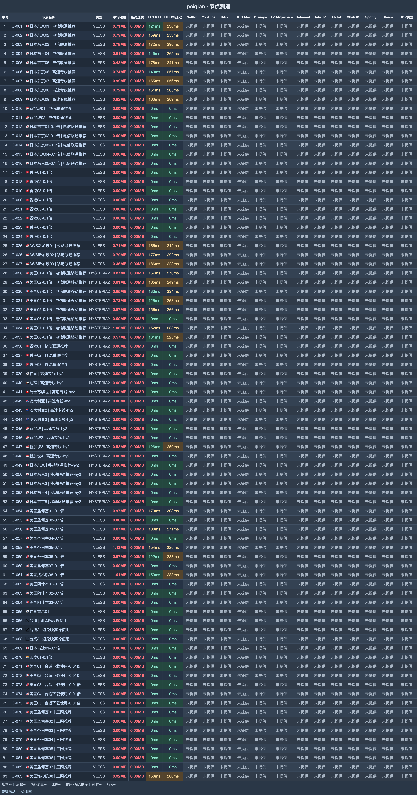

# 赔钱机场｜1.5 元月付试 100G，大用量重点看 0.1 倍节点（2026-11-06 更新）

> **一句话评价：水桶可乐对应 20TB，0.1 倍节点在同额度下约能传 10 倍数据；选档前先核对地区与每日规则。**
>
> 👉 **[官网注册](https://xn--mes358aby2apfg.com/register?code=qhyiSP1G&cover=sfw)** · 用 1.5 元月付确认美区和运营商适配，随后再决定流量档位。

**适合：**

- 经常下载、挂 PT 或播放 4K，流量比低延迟更值得优先比较。
- 愿意围绕 0.1 倍节点安排用量，减少同传输量的扣费额度。
- 日常以美国线路为主，能利用美区集中的低倍率节点。

**不适合：**

- 要求订阅中所有节点同时可用；历史连通结果没有达到这一条件。
- 不接受每天流量限制，不能只因月额度大就忽略公平使用条款。

| 选购项 | 内容 |
|---|---|
| 月付起点 | 1.5 元/月 100G |
| 节点记录 | 83 个，26 个连通 |
| 延迟中位 | 154 ms |
| 速度中位 | 6.5 MB/s |
| 最快平均速度 | 9.2 MB/s |
| 低倍率节点 | 12 个 0.1 倍节点 |
| 协议 | VLESS / Hysteria2 |

**关于赔钱机场**：赔钱机场也常写作 peiqian，可乐命名对应不同容量的周期档，另列不限时流量订阅和企业套餐。检索赔钱机场入口后，选购应先确认常用美区节点与计费倍率，而不是把所有标称额度当成相同使用方式。

## 套餐

| 套餐名称 | 流量 | 设备 | 限速 | 一次付 | 月付 | 季付 | 半年 | 年付 | 两年 | 三年 |
|---|---|---|---|---|---|---|---|---|---|---|
| 大瓶可乐 | 1000G | 20 | 不限 | — | **5.99 元** | — | 34.99 | 68.99 | 133.99 | 199.99 |
| 超大瓶可乐 | 5000G | 30 | 不限 | — | **12.99 元** | — | 73.99 | 139.99 | 265.99 | 375.99 |
| 水桶可乐 | 20000G | 40 | 不限 | — | **39.99 元** | — | 225.99 | 429.99 | 810 | 1150.99 |
| 中瓶可乐 | 500G | 15 | 不限 | — | **2.99 元** | — | 17.99 | 34.99 | 68.99 | 99.99 |
| 一瓶盖可乐 | 100G | 10 | 不限 | — | **1.50 元** | — | 9 | 18 | 36 | 54 |
| 企业套餐(300台设备数量支持) | 99999G | 300 | 不限 | — | **280 元** | 798 | 1515 | 2888 | 5488 | 8088 |
| 一会嗦一口(不限时长永久订阅) | 1000G 一次性 | 10 | 不限 | **18.90 元** | — | — | — | — | — | — |
| 一会嗦(不限时长永久订阅) | 4000G 一次性 | 20 | 不限 | **68.90 元** | — | — | — | — | — | — |
| 一大口(不限时长永久订阅) | 6000G 一次性 | 30 | 不限 | **88.99 元** | — | — | — | — | — | — |
| 至尊订阅(不限时长永久订阅) | 20000G 一次性 | 40 | 不限 | **228.80 元** | — | — | — | — | — | — |
| 顶级王冠99999GB流量订阅(不限时长永久订阅) | 99999G 一次性 | 300 | 不限 | **688 元** | — | — | — | — | — | — |

> 公平使用条款包含“每天流量限制为总的20%”。同额度用于 0.1 倍节点，实际传输量约可达到标称 10 倍；一瓶盖可乐至水桶可乐的月付范围约为 67～500 GB/元。

## 测速

历史输入包含 **83 个节点**，该轮连通 **26 个**，最快平均速度记为 **9.2 MB/s**。下表展示均速靠前的节点，图示位置见下图。

测试时间为 **2026-10-17 18:39–18:48**；环境为中国大陆家宽出口香港，每节点连测 **3 次取最优**。

| 节点名称 | 协议类型 | 延迟 | 完整请求 | 平均速度 | 最高速度 |
|---|---|---|---|---|---|
| 🇺🇸美国圣何塞05-0.1倍 | VLESS | 152ms | 223ms | **9.15 MB/s** | 11.14 MB/s |
| 🇺🇸美国07-0.1倍 \| 电信联通移动推荐 | HYSTERIA2 | 149ms | 280ms | **8.92 MB/s** | 11.15 MB/s |
| 🇺🇸美国洛杉矶08-0.1倍 | VLESS | 151ms | 292ms | **8.34 MB/s** | 11.60 MB/s |
| 🇺🇸美国圣何塞01-0.1倍 | VLESS | 177ms | 308ms | **7.91 MB/s** | 10.87 MB/s |
| 🇺🇸美国洛杉矶08 \| 三网推荐 | VLESS | 158ms | 261ms | **7.58 MB/s** | 12.01 MB/s |
| 🇯🇵日本东京07 \| 高速专线推荐 | VLESS | 165ms | 262ms | **7.54 MB/s** | 12.35 MB/s |
| 🇺🇸美国02-0.1倍 \| 电信联通移动推荐 | HYSTERIA2 | 184ms | 254ms | **7.52 MB/s** | 10.97 MB/s |
| 🇺🇸美国圣何塞03-0.1倍 | VLESS | 186ms | 264ms | **7.15 MB/s** | 11.66 MB/s |

**地区分布**：地区配额合计 83 个节点：美国 32、日本 20、香港 11、新加坡 9；台湾和澳大利亚各 3，韩国 2，迪拜、瑞士、印度各 1。0.1 倍线路集中在美国。

## 怎么选

- 只想确认能否日常使用，先选 1.5 元月付。找到适配的 0.1 倍线路后，同一传输量只扣十分之一额度。
- 美区使用占主要部分时先比较美国节点；流量不足再升可乐档位，企业与不限时商品单独判断付款方式。
- “电信联通推荐”“三网推荐”是选线提示，仍应按自己的运营商试用。每天 20% 用量规则不适合自己时，别为了大额度直接购买。

## 注册

👉 **[官网注册](https://xn--mes358aby2apfg.com/register?code=qhyiSP1G&cover=sfw)** · 用 1.5 元月付确认美区和运营商适配，随后再决定流量档位。

*本文含推广链接，经此入口注册或购买，本站可能获得佣金。*

## 更新

- **2026-11-06** — 每日复核：套餐、价格与公告无变化；多账号发布对齐核查完成。
- **2026-11-05** — 每日复核：套餐、价格与公告无变化；多账号发布对齐核查完成。
- **2026-11-04** — 每日复核：套餐、价格与公告无变化；多账号发布对齐核查完成。
- **2026-10-18** — 一瓶盖可乐的已有复核报价保持 1.5 元，公告记录未增加。
- **2026-10-17** — 83 个节点测试存档中，26 个连通；其中低倍率 0.1 倍节点共 12 个。

---
*测速记录日期 2026-10-17 18:39–18:48，中国大陆家宽出口香港，每节点连测 3 次取最优。*
*价格与套餐以商家实时显示为准。*

展开相关搜索词

相关关键词：赔钱机场、peiqian、赔钱机场测评、赔钱机场套餐、赔钱机场官网、赔钱机场注册、赔钱机场入口、赔钱机场订阅、机场评测、机场套餐、机场推荐2026、科学上网、VPN订阅、clash配置、代理服务

